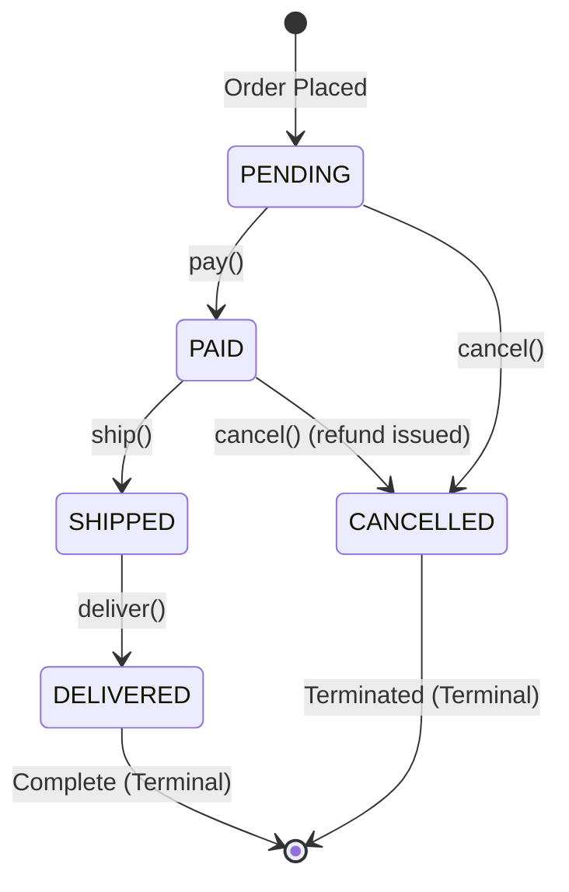

# 🔄 State Pattern

> **Category:** Behavioral Design Pattern (Gang of Four)

---

## 1. What is the State Pattern?

The **State Pattern** allows an object to alter its behavior when its internal state changes. The object will appear to change its class.

### The Problem It Solves
Consider an e-commerce **Order**. As an order progresses through its lifecycle (`PENDING` → `PAID` → `SHIPPED` → `DELIVERED`, or `CANCELLED`), the operations you can perform on it depend entirely on its current status:
* You **can** pay for a pending order, but **cannot** pay for an order that is already paid, shipped, or cancelled.
* You **can** ship a paid order, but **cannot** ship an unpaid order or re-ship an already delivered order.
* You **can** cancel an unpaid or paid order (issuing a refund), but **cannot** cancel an order already in transit with the courier.

#### The Naive Approach (Giant `switch` or `if/else` Cascades):
```java
// ❌ Fragile, monolithic conditional checks:
public void shipOrder(Order order) {
    if (order.getStatus() == OrderStatus.PENDING) {
        throw new IllegalStateException("Cannot ship unpaid order!");
    } else if (order.getStatus() == OrderStatus.PAID) {
        order.setStatus(OrderStatus.SHIPPED);
    } else if (order.getStatus() == OrderStatus.SHIPPED) {
        throw new IllegalStateException("Already shipped!");
    } else if (order.getStatus() == OrderStatus.CANCELLED) {
        throw new IllegalStateException("Cannot ship cancelled order!");
    }
}
```

**Why this breaks down as systems grow:**
1. **Violates Single Responsibility Principle (SRP):** Business rules for every single state are crammed together in the `Order` class or service methods.
2. **Violates Open/Closed Principle (OCP):** Adding a new state (e.g. `REFUNDED` or `ON_HOLD`) requires editing and re-testing every single method with `if/else` checks across the codebase.
3. **High Bug Risk:** Forgetting to handle a state condition in just one method leads to invalid state transitions and subtle runtime bugs.

---

## 2. The Solution: The State Pattern

Instead of maintaining rigid conditional statements, the State Pattern encapsulates state-specific behavior into separate **State classes**. 

The `Order` (Context) delegates all lifecycle actions (`pay`, `ship`, `deliver`, `cancel`) to its current `OrderState` object. When a state transition occurs, the context simply replaces its current state object with the new one.



---

## 3. The Code Architecture

```text
               +------------------------------------+
               |      <<interface>> OrderState      |
               +------------------------------------+
               | + pay(Order): void                 |
               | + ship(Order): void                |
               | + deliver(Order): void             |
               | + cancel(Order): void              |
               | + getName(): String                |
               +------------------------------------+
                                  ^
         +-------------+----------+----------+-------------+
         |             |                     |             |
+----------------+ +---------------+ +---------------+ +------------------+ +------------------+
| PendingOrder   | | PaidOrder     | | ShippedOrder  | | DeliveredOrder   | | CancelledOrder   |
| State          | | State         | | State         | | State            | | State            |
+----------------+ +---------------+ +---------------+ +------------------+ +------------------+
| pay() -> PAID  | | ship() -> SHIP| | deliver()->DLV| | (Terminal State) | | (Terminal State) |
| cancel()->CNC  | | cancel()->CNC | |               | | Rejects all      | | Rejects all      |
+----------------+ +---------------+ +---------------+ +------------------+ +------------------+
```

### Components:

1. **State Interface ([`state/OrderState.java`](file:///home/mohamedtoukhy/Java/DesginPattern/state-pattern/src/state/OrderState.java))**:
   Defines all valid actions that can be requested on an order:
   ```java
   public interface OrderState {
       void pay(Order order);
       void ship(Order order);
       void deliver(Order order);
       void cancel(Order order);
       String getName();
   }
   ```

2. **Concrete States ([`state/`](file:///home/mohamedtoukhy/Java/DesginPattern/state-pattern/src/state/))**:
   * **`PendingOrderState`**: Initial state; permits `pay()` (transitions to `PaidOrderState`) and `cancel()` (transitions to `CancelledOrderState`).
   * **`PaidOrderState`**: Permits `ship()` (transitions to `ShippedOrderState`) and `cancel()` (issues refund, transitions to `CancelledOrderState`).
   * **`ShippedOrderState`**: Parcel is in transit; permits `deliver()` (transitions to `DeliveredOrderState`), blocks cancellation.
   * **`DeliveredOrderState`**: Terminal success; order is complete. Rejects forward actions.
   * **`CancelledOrderState`**: Terminal failure; order is aborted. Rejects all actions.

3. **Context Class ([`model/Order.java`](file:///home/mohamedtoukhy/Java/DesginPattern/state-pattern/src/model/Order.java))**:
   Holds a reference to the current state and delegates calls:
   ```java
   public class Order {
       private OrderState state = new PendingOrderState();

       public void pay()     { state.pay(this); }
       public void ship()    { state.ship(this); }
       public void deliver() { state.deliver(this); }
       public void cancel()  { state.cancel(this); }

       public void setState(OrderState state) { this.state = state; }
       public OrderState getState()           { return state; }
   }
   ```

---

## 4. Behavior Matrix (Allowed vs. Disallowed Actions)

| Action | `PENDING` | `PAID` | `SHIPPED` | `DELIVERED` | `CANCELLED` |
| :--- | :---: | :---: | :---: | :---: | :---: |
| **`pay()`** |  Transitions to `PAID` | ❌ Already paid | ❌ Already paid | ❌ Already completed | ❌ Cancelled order |
| **`ship()`** | ❌ Unpaid order |  Transitions to `SHIPPED` | ❌ Already shipped | ❌ Already delivered | ❌ Cancelled order |
| **`deliver()`** | ❌ Unpaid order | ❌ Not shipped yet |  Transitions to `DELIVERED` | ❌ Already delivered | ❌ Cancelled order |
| **`cancel()`** |  Transitions to `CANCELLED` |  Refunds & transitions to `CANCELLED` | ❌ In transit (return needed) | ❌ Delivered (return needed) | ❌ Already cancelled |

---

## 5. How the Example Reflects the Design Pattern

| Role in Pattern | Class in Project | Responsibilities |
| :--- | :--- | :--- |
| **Context** | `Order` | Maintains the current state instance and exposes domain operations to clients. |
| **State Interface** | `OrderState` | Defines the contract for all state-dependent actions (`pay`, `ship`, `deliver`, `cancel`). |
| **Concrete States** | `PendingOrderState`, `PaidOrderState`, `ShippedOrderState`, `DeliveredOrderState`, `CancelledOrderState` | Implement state-specific behaviors and drive transitions on the context (`order.setState(...)`). |

---

## 6. How to Use This Design Pattern

### Client Code ([`Main.java`](file:///home/mohamedtoukhy/Java/DesginPattern/state-pattern/src/Main.java))
```java
// 1. Normal order lifecycle
Order order = new Order("ORD-101");
System.out.println(order.getStatusName()); // PENDING

order.pay();      // Transitions to PAID
order.ship();     // Transitions to SHIPPED
order.deliver();  // Transitions to DELIVERED

// 2. Enforcing state rules:
order.cancel();   // ❌ Cannot cancel order: Order has already been delivered.
```

### How to Compile & Run
```bash
cd state-pattern
javac src/model/*.java src/strategy/*.java src/factory/*.java src/payment/*.java src/checkout/*.java src/state/*.java src/*.java
java -cp src Main
```

---

## 7. When to Use the State Pattern

Use the State Pattern when:
1. **An object's behavior depends on its state:** Its operations change dynamically depending on the current phase or lifecycle status.
2. **You want to eliminate complex conditional ladders:** Replace multi-branch `if/else` or `switch` statements with clean polymorphic classes.
3. **State transitions must follow strict business rules:** Each state explicitly controls which transitions are legal and which are forbidden.

---

## 8. Other Real-World Use Cases

* **TCP Connection Lifecycle (JDK Networking):**
  * TCP sockets transition between `LISTEN`, `SYN_SENT`, `ESTABLISHED`, `FIN_WAIT`, and `CLOSED`, where network read/write operations behave differently depending on the connection state.
* **Workflow & Document Management:**
  * Documents transitioning through `DRAFT` → `UNDER_REVIEW` → `PUBLISHED` → `ARCHIVED`.
* **Media Players:**
  * `PlayingState`, `PausedState`, `StoppedState` responding differently to `play()`, `pause()`, and `stop()` buttons.
* **Vending Machines / ATM Machines:**
  * Handling coin insertion, card reading, PIN verification, and dispensing depending on whether a card is inserted or balance is confirmed.
* **Spring StateMachine:**
  * Enterprise orchestration framework using state machines for complex order fulfillment, provisioning, and payment workflows.
